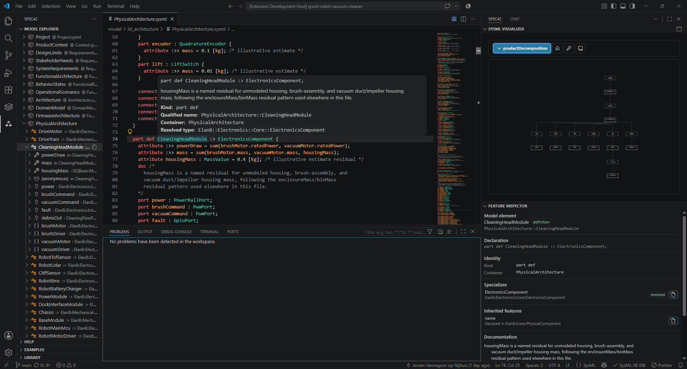

# Spec42

Spec42 is open, local-first tooling for [SysML v2](https://www.omg.org/sysml/sysmlv2/) and KerML: edit textual models with live feedback, understand structure and behavior beyond the source, and keep the same analysis engine in the editor, CI, and assistant workflows.


[](LICENSE)
[](https://marketplace.visualstudio.com/items?itemName=Elan8.spec42)
[](https://github.com/elan8/spec42/releases)



## Why Spec42

One analysis engine backs the editor, the CLI, GitHub Actions, generators and assistant
integrations, so what you see while modeling is what CI checks. The language server, standard
library and Elan8 domain libraries ship with Spec42: it works offline, and your models stay in your
own repositories.

## What you get

- **An editor for SysML v2 and KerML** — diagnostics, highlighting, navigation, rename and
  formatting, with completion and quick fixes that add missing imports for you.
- **Views of the model, not just the text** — diagrams and the Feature Inspector show resolved
  typing, inheritance, relationships and values.
- **Validation for automation** — `spec42 check` uses the same engine, with text, JSON, SARIF and
  JUnit output.
- **Generators** — sandboxed WebAssembly plugins read the same analysis as the editor.
- **Libraries** — the OMG SysML libraries and searchable Elan8 domain libraries are bundled, and
  you can add your own.
- **Assistant support** — Copilot Language Model Tools in VS Code, and CLI helpers for other AI
  hosts.

## Where Spec42 fits

| Surface | Role |
| --- | --- |
| **VS Code** | Primary modeling environment: edit, navigate, diagram, inspect. |
| **CLI** | `check`, `model-export`, `generate`, `diagram`, `doctor` and library management. |
| **GitHub Action** | Repeatable model validation with optional SARIF upload. |
| **LM Tools** | Validation and model context for AI-assisted workflows. |
| **Zed** | Lightweight editor support with the same server family. |

## Views

| View | What it is for |
| --- | --- |
| General View | Structure and relationships across the exposed model. |
| Interconnection View | Parts, ports, connectors, and architecture wiring. |
| Action Flow View | Control and data flow through actions. |
| State Transition View | States and transitions for lifecycle behavior. |
| Sequence View | Lifelines and messages for interaction-oriented models. |
| Browser View | Hierarchical membership browsing. |
| Grid View | Tabular arrangement of exposed elements and relationships. |
| Geometry View | Spatial items (partial while authored geometry and 3D catch up). |

## Examples

| Example | Best for |
| --- | --- |
| [`examples/office`](examples/office/README.md) | Smallest first read: parts, ports, connections, simple behavior. |
| [`examples/timer`](examples/timer/README.md) | Recommended first substantial model. |
| [`examples/intersection`](examples/intersection/README.md) | Controllers and state machines. |
| [`examples/webshop`](examples/webshop/README.md) | Software architecture, requirements, and views. |
| [`examples/drone`](examples/drone/README.md) | Broader system decomposition and mission behavior. |

## Get started

1. Install **[SysML v2 Editor](https://marketplace.visualstudio.com/items?itemName=Elan8.spec42)** from the VS Code Marketplace.
2. Open a `.sysml` / `.kerml` file, or try the bundled **timer** example from the Spec42 sidebar.
3. Follow the full walkthrough in **[Getting Started](docs/user/GETTING-STARTED.md)**.

To start a clean multi-file workspace from the CLI, run:

```bash
spec42 init my-model
```

The target must be new or empty; `init` never overwrites existing files and validates the generated workspace before reporting success.

CLI and CI users can download platform archives from [GitHub Releases](https://github.com/elan8/spec42/releases). Setup details for Actions, assistants, and troubleshooting live in the docs linked below.

## Documentation

- [User documentation](docs/README.md) — getting started, diagram view, Feature Inspector, libraries
- [VS Code extension](vscode/README.md)
- [GitHub Action](docs/user/GITHUB-ACTION.md)
- [AI assistants](docs/user/AI-ASSISTANTS.md)
- [Troubleshooting](docs/user/TROUBLESHOOTING.md)
- [What's included](docs/reference/WHATS-INCLUDED.md)
- [Conformance matrix](docs/reference/CONFORMANCE-MATRIX.md)
- [Contributor development guide](DEVELOPMENT.md)

## License

MIT. See [LICENSE](LICENSE). The embedded SysML standard library is subject to separate licensing; see [THIRD_PARTY_NOTICES.md](THIRD_PARTY_NOTICES.md).
